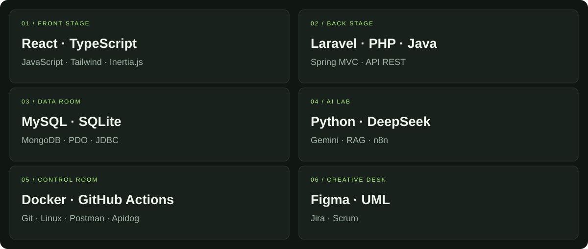
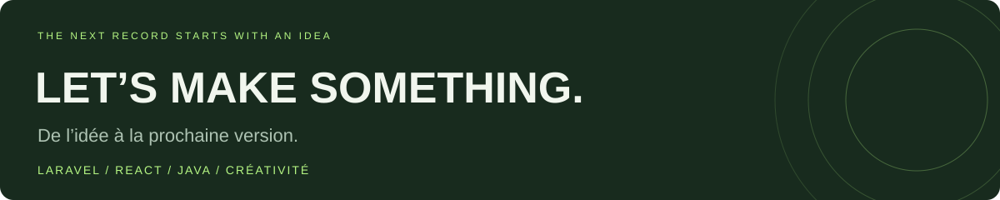

<b>FULL STACK DEVELOPER · CREATIVE MIND · WORKING EVERYDAY</b>

<a href="#01--liner-notes">À propos</a> · <a href="#02--selected-tracks">Projets</a> · <a href="#03--studio-gear">Stack</a> · <a href="#04--behind-the-record">Parcours</a> · <a href="#05--next-session">Contact</a>

## 01 · Liner notes

**Ayoub Ouharda, alias LOKI. Développeur Full Stack, Maroc.**

Je conçois des applications web avec **Laravel et React**, des API en **Java**, et des solutions intégrant l’**IA**. Mon parcours mêle missions freelance, stage en entreprise et projets en équipe agile. Actuellement en formation Full Stack à **YouCode Nador**.

En dehors du code : **filmmaking, création de contenu et organisation d’événements**. Une même envie de créer, à l’écran comme dans mes projets.

> **Working everyday.** Une idée, du code, une nouvelle version.

## 02 · Selected tracks

**La sélection LOKI.** Quatre projets, quatre contextes : une mission client, un stage PFA, une application PHP et une API Java.

**[Pizza Noche ↗](https://github.com/Mehdi-133/PizzaNoche) · Freelance** — Projet réalisé pour un client, dans un dépôt collaboratif.

**[AgriFober ↗](https://github.com/10LOKI/AgriFober) · Stage PFA — DEVTI Technologie** 
Contribution aux espaces Administration et Agriculteur : API REST sécurisée, dashboard et application mobile. Intégration d’un assistant IA contextuel et de données météo pour accompagner le suivi agricole. 
**Laravel 11 · Sanctum · Inertia.js · Vue.js · Flutter · MySQL · DeepSeek / RAG**

**[Qodex V2 ↗](https://github.com/10LOKI/QodexV2) · Application web** 
Espace étudiant pour passer des quiz, consulter ses scores et suivre ses tentatives. Architecture orientée objet, gestion des sessions, requêtes préparées et protections CSRF. 
**PHP · MySQL · PDO · HTML / CSS**

**[ClickTrack ↗](https://github.com/10LOKI/ClickTrack) · API Java** 
Création de liens de tracking et suivi des clics par lien et par offre. Séparation controller / service / repository, validation des requêtes et tests de concurrence. Stockage en mémoire. 
**Java 17 · Spring MVC · Maven · Tomcat · Apidog**

## 03 · Studio gear

<b>Ouvrir la fiche technique du studio</b>

| Univers | Technologies & outils |
| :--- | :--- |
| **Interfaces** | React · TypeScript · JavaScript · Tailwind CSS · Inertia.js |
| **Back-end & API** | Laravel · PHP · Java · Spring MVC · API REST |
| **Données** | MySQL · SQLite · MongoDB · PDO · JDBC |
| **IA & automatisation** | Python · Gemini · DeepSeek · RAG · n8n |
| **Livraison** | Docker · Git · GitHub Actions · Linux · Postman · Apidog |
| **Conception & équipe** | Figma · UML · Jira · Scrum |

## 04 · Behind the record

| La période | L’expérience | Ce que j’y construis |
| :--- | :--- | :--- |
| **2024 → aujourd’hui** | Freelance · Full Stack | Des solutions sur mesure pour des clients, dont Pizza Noche. |
| **2025 → 2027** | YouCode Nador · Formation Full Stack | Une pratique du développement à travers des projets et le travail en équipe agile. |
| **Mai → juin 2026** | DEVTI Technologie · Stage PFA | Les espaces Administration et Agriculteur d’AgriFober, entre API, web, mobile et IA. |

### La face B : création & collectif

**Filmmaking · Création de contenu · Organisation d’événements**

J’aime autant construire une expérience que raconter une histoire. Le code et la création visuelle occupent chacun leur place dans mon univers.

**En équipe :** Scrum Master sur LocalMart et coordination Scrum / architecture API sur ActTogether, projet arrivé **2ᵉ lors d’un hackathon**.

## 05 · Next session

Approfondir **Java et l’architecture des API**, poursuivre mon parcours **Full Stack** et créer des expériences utiles avec l’**IA**.

<b>Un projet à construire ensemble ?</b> Mission freelance, collaboration ou échange technique : <a href="mailto:ayoubouharda33@gmail.com">ayoubouharda33@gmail.com</a>

<a href="https://10loki.github.io/Portfolio-/">Portfolio ↗</a> &nbsp;·&nbsp; <a href="https://www.linkedin.com/in/ayoub-ouharda/">LinkedIn ↗</a> &nbsp;·&nbsp; <a href="https://github.com/10LOKI?tab=repositories">Toute la collection ↗</a>

LOKI / INDEPENDENT DEVELOPER COLLECTION · Code, créativité et progression.

