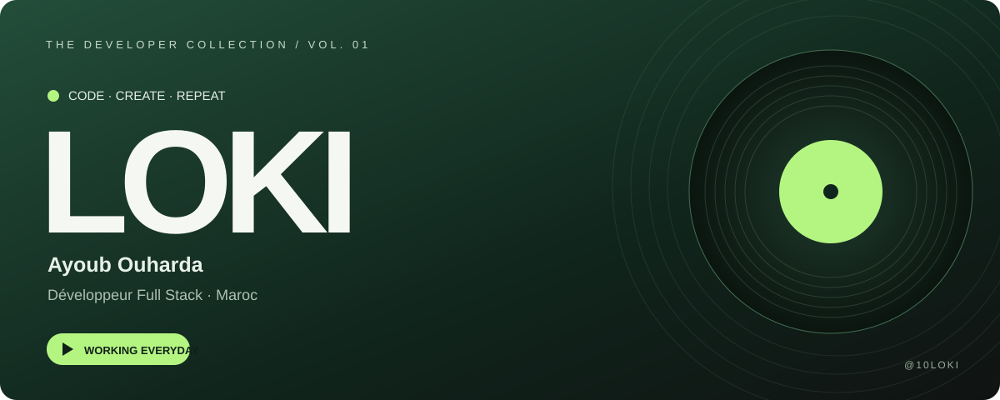
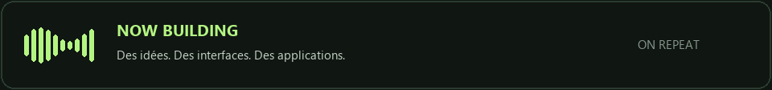
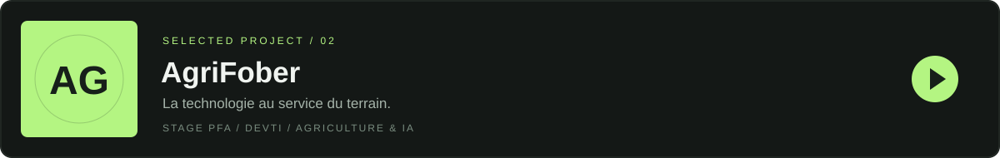
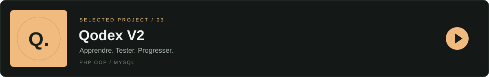
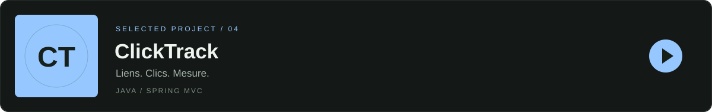

<a href="https://10loki.github.io/Portfolio-/">Portfolio ↗</a> &nbsp;·&nbsp; <a href="https://www.linkedin.com/in/ayoub-ouharda/">LinkedIn ↗</a> &nbsp;·&nbsp; <a href="mailto:ayoubouharda33@gmail.com">Me contacter ↗</a>

## Sur la face A

**Ayoub Ouharda, alias LOKI. Développeur Full Stack, Maroc.**

Je conçois des applications web avec **Laravel et React**, des API en **Java**, et des solutions intégrant l’**IA**. Mon parcours mêle missions freelance, stage en entreprise et projets en équipe agile. Actuellement en formation Full Stack à **YouCode Nador**.

En dehors du code : **filmmaking, création de contenu et organisation d’événements**. Une même envie de créer, à l’écran comme dans mes projets.

> **Working everyday.** Une idée, du code, une nouvelle version.

## Les titres à découvrir

Quatre projets qui représentent mon parcours : freelance, expérience en entreprise et développement web.

**[Pizza Noche ↗](https://github.com/Mehdi-133/PizzaNoche) · Freelance** — Projet réalisé pour un client, dans un dépôt collaboratif.

**[AgriFober ↗](https://github.com/10LOKI/AgriFober) · Stage PFA — DEVTI Technologie** 
Contribution aux espaces Administration et Agriculteur : API REST sécurisée, dashboard et application mobile. Intégration d’un assistant IA contextuel et de données météo pour accompagner le suivi agricole. 
**Laravel 11 · Sanctum · Inertia.js · Vue.js · Flutter · MySQL · DeepSeek / RAG**

**[Qodex V2 ↗](https://github.com/10LOKI/QodexV2) · Application web** 
Espace étudiant pour passer des quiz, consulter ses scores et suivre ses tentatives. Architecture orientée objet, gestion des sessions, requêtes préparées et protections CSRF. 
**PHP · MySQL · PDO · HTML / CSS**

**[ClickTrack ↗](https://github.com/10LOKI/ClickTrack) · API Java** 
Création de liens de tracking et suivi des clics par lien et par offre. Séparation controller / service / repository, validation des requêtes et tests de concurrence. Stockage en mémoire. 
**Java 17 · Spring MVC · Maven · Tomcat · Apidog**

## Dans le studio

| Univers | Technologies & outils |
| :--- | :--- |
| **Interfaces** | React · TypeScript · JavaScript · Tailwind CSS · Inertia.js |
| **Back-end & API** | Laravel · PHP · Java · Spring MVC · API REST |
| **Données** | MySQL · SQLite · MongoDB |
| **IA & automatisation** | Python · Gemini · DeepSeek · RAG · n8n |
| **Livraison & collaboration** | Docker · Git · GitHub Actions · Linux · Postman · Apidog |
| **Conception & équipe** | Figma · UML · Jira · Scrum |

## Les prochaines pistes

Poursuivre mon parcours Full Stack, approfondir Java et construire des expériences utiles avec l’IA. Pour une mission, une collaboration ou simplement parler d’un projet : **[écris-moi](mailto:ayoubouharda33@gmail.com)**.

---

<b>Le code est ouvert. La suite s’écrit.</b> LOKI · Code, créativité et progression.

<a href="https://github.com/10LOKI?tab=repositories">Explorer toute la collection ↗</a>

